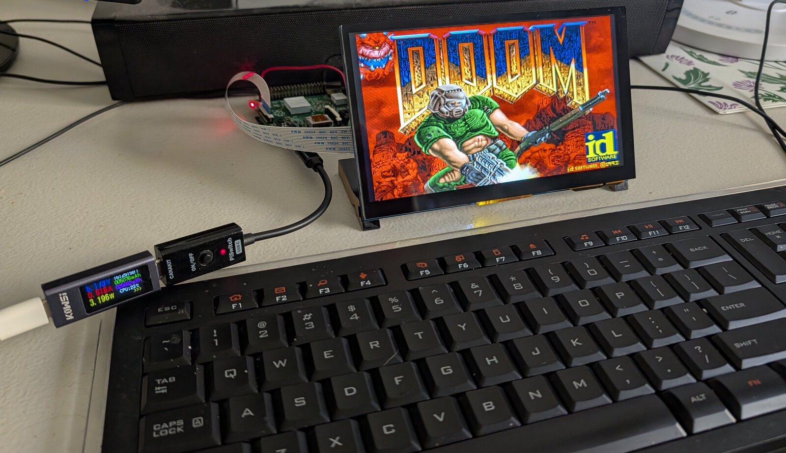
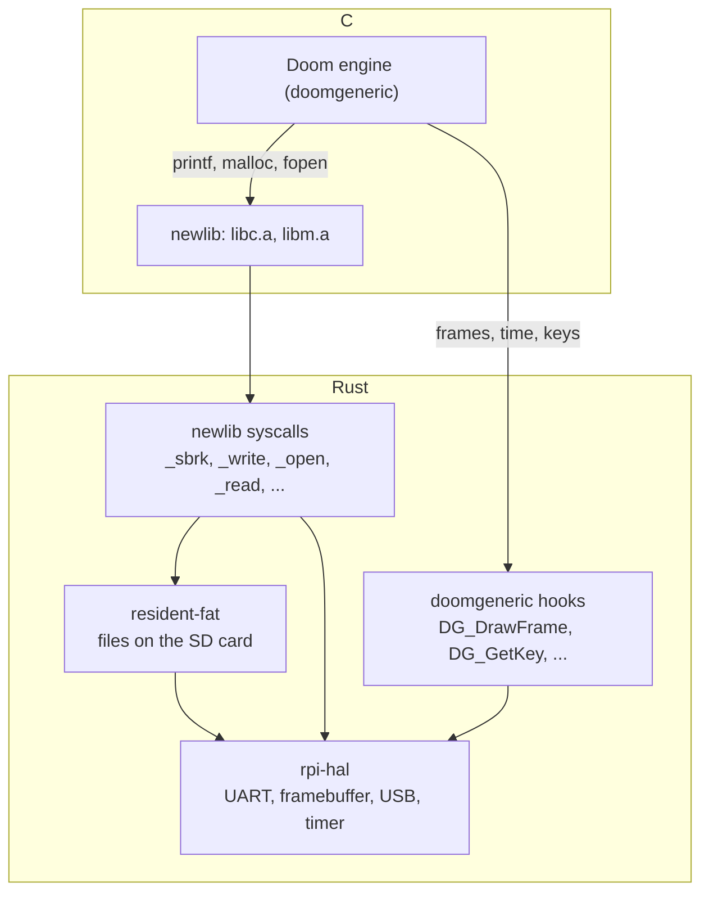

Sooner or later, every piece of hardware gets asked the same question:
can it run Doom? Calculators, printers and pregnancy tests have all
answered yes. A Raspberry Pi running Linux is too easy to count, so this
series asks the question of a Pi with no operating system at all: just
[rpi-hal](/rpi-hal/crates/hal/), a Pi 2B, and a copy of `DOOM.WAD`.

It runs. This series covers how, in four parts:

1. **A C library with no operating system** (this post): getting a
   1990s C engine to build, start and read its game data.
2. **The framebuffer**: getting the picture on screen, and keeping its
   proportions.
3. **USB input**: a keyboard, which on a Pi means writing a USB host.
4. **Audio**: sound effects and music, on a core of their own.

The code is in [rpi-doom](https://github.com/joeferner/rpi-doom).



## Doom on anything

id Software released Doom's source in 1997 and put it under the GPL in
1999, and ports have been piling up ever since. The one that makes
porting easy is [doomgeneric](https://github.com/ozkl/doomgeneric). It
cuts the engine's connection to the platform down to a handful of
functions you write:

| Function | What the engine wants |
| --- | --- |
| `DG_Init` | Set up whatever you need |
| `DG_DrawFrame` | Show the finished frame |
| `DG_SleepMs` | Wait this many milliseconds |
| `DG_GetTicksMs` | Milliseconds since startup |
| `DG_GetKey` | The next key press or release, if any |
| `DG_SetWindowTitle` | Name the window |

That looks like an afternoon's work, and the hooks themselves are. The
catch is everything the engine uses *besides* those hooks. Doom is
1990s C, and it takes a C library for granted: `printf` for its
startup log, `malloc` for memory, `fopen` and `fread` for the WAD,
`<math.h>`, `<string.h>`. On a bare-metal Pi, none of it exists.

## newlib

The usual answer on embedded systems is
[newlib](https://sourceware.org/newlib/), a C library meant for machines
without an operating system. The ARM toolchain ships it ready-built
(`arm-none-eabi-newlib` on most distributions) as two archives:

- `libc.a`: `printf`, `malloc`, `fopen`, `strcmp` and the rest of the
  standard C library.
- `libm.a`: the maths functions in `<math.h>`.

newlib is portable because it never touches hardware itself. When
`malloc` needs more memory it calls `_sbrk`; `printf` ends in `_write`;
`fopen` and `fread` end in `_open` and `_read`. On Linux those are
system calls. On bare metal, newlib leaves them for you to write, about
fifteen functions in all.

So that's the shape of the port: the engine and newlib are C on top,
and the layer underneath them is Rust. The engine reaches it two ways:
through newlib for memory, files and its log, and directly through the
doomgeneric hooks for the screen, the clock and the keyboard.



## Building the C

The engine is compiled by `build.rs` with the
[cc](https://crates.io/crates/cc) crate and `arm-none-eabi-gcc`. The
flags have to match the Rust target, `armv7a-none-eabi`, exactly:

```rust
const ARCH_FLAGS: &[&str] = &[
    "-marm",                 // 32-bit ARM instructions, not Thumb
    "-march=armv7-a",
    "-mfloat-abi=soft",      // no FPU registers in the calling convention
    "-mno-unaligned-access", // the Rust target assumes strict alignment
];
```

The same flags pick which newlib to link. The toolchain ships one build
of `libc.a` per architecture and float ABI, and asking the compiler with
the same flags finds the right one:

```rust
Command::new("arm-none-eabi-gcc")
    .args(ARCH_FLAGS)
    .arg("-print-file-name=libc.a")
```

## The OS layer, in Rust

Each newlib syscall is an `extern "C"` function in
[`src/newlib.rs`](https://github.com/joeferner/rpi-doom/blob/main/src/newlib.rs).
Most are short.

**Memory.** `_sbrk` grows newlib's heap, and here it hands out a 32 MiB
block carved from the Rust heap at boot. Doom's zone allocator takes 6
MiB of that up front; the rest goes to newlib's buffers and the engine's
smaller allocations.

```rust
#[unsafe(no_mangle)]
pub extern "C" fn _sbrk(increment: isize) -> *mut c_void {
    let grown = critical_section::with(|cs| {
        let arena = &mut *ARENA.borrow_ref_mut(cs);
        let used = arena.used.checked_add_signed(increment)?;
        if used > arena.len {
            return None;
        }
        let old_end = arena.base.wrapping_add(arena.used);
        arena.used = used;
        Some(old_end)
    });
    match grown {
        Some(old_end) => old_end.cast(),
        None => {
            fail(Errno::NoMemory);
            usize::MAX as *mut c_void // (void *)-1
        }
    }
}
```

**The console.** `_write` to stdout or stderr goes to the serial
console. `printf` writes in pieces, so the bytes are gathered until a
newline and logged as whole lines.

**`_fstat`** is where the C side's memory layout matters. newlib asks it
what a file descriptor is and how long the file is, through a
`struct stat` it allocated itself. The Rust side has to write into
exactly the right offsets, so it carries its own `repr(C)` copy, with
the layout checked at compile time:

```rust
#[repr(C)]
pub struct Stat {
    _dev_ino: [u16; 2],
    mode: u32,
    _nlink_uid_gid_rdev: [u16; 4],
    size: c_long,
    _rest: [u8; 68],
}

const _: () = assert!(size_of::<Stat>() == 88);
const _: () = assert!(core::mem::offset_of!(Stat, mode) == 4);
const _: () = assert!(core::mem::offset_of!(Stat, size) == 16);
```

It also matters what `_fstat` reports. The console descriptors say
they're character devices, which is what makes newlib line-buffer
stdout, so the startup log arrives a line at a time.

**Exiting.** Quit Game, and every fatal `I_Error`, end in `_exit`.
There's nothing to return to, so it logs the status, blanks the screen
and halts. Without the blanking, the last frame stays up and looks
exactly like a hang.

## Files on the SD card

`_open`, `_read`, `_lseek` and `_write` go to a small open-file table in
[`src/files.rs`](https://github.com/joeferner/rpi-doom/blob/main/src/files.rs),
over [resident-fat](https://crates.io/crates/resident-fat), a FAT32
crate that keeps the card's allocation table and directories in RAM.
Relative paths resolve under `doom/` on the card, so the engine finds
its WAD exactly where a DOS install would have it: in its working
directory.

To try it yourself, put a WAD in a local `doom/` directory and run:

```sh
make sd-card-release
```

That builds the game and assembles a complete card in
`target/sd-card-release/`: the Pi's boot firmware, `config.txt`, the
game as `kernel7.img`, and the WAD in `doom/`. Copy everything in it
onto a FAT32 card and power on. (For working on the code there's
`make sd-card-dev`, which puts [rpi-loader](/rpi-hal/blog/rpi-loader/)
on the card instead, so each build goes over a serial cable.)

## First boot

With the hooks drawing frames (part 2) and no input yet, the engine
starts, loads `DOOM.WAD` and runs its attract loop: the title screen,
then demos of the first levels, playing themselves.

This is the serial console from a boot of the finished port (with no
keyboard plugged in, as it says). Each line is stamped with the seconds
since the kernel started. The first lines are the Rust side setting up
the board; from `Doom Generic 0.1` on, it's the engine's own `printf`s,
arriving through `_write`:

```text
[    0.000] rpi-doom: hello from the Raspberry Pi 2 (B)
[    0.004] arm: 900 MHz
[    0.005] heap: 942 MiB
[    0.210] storage: FAT volume at block 2048
[    0.213] storage: 247255 clusters of 4 KiB, 965 KiB of allocation table in RAM
[    0.220] audio: core 1, 48828 Hz
[    1.163] usb: no keyboard found; plug one in before booting
[    1.167] display: 800x480
[    1.173] framebuffer: 667x400, pitch 2688 bytes, at 0x3eaf2000
[    1.179]                            Doom Generic 0.1
[    1.183] Z_Init: Init zone memory allocation daemon.
[    1.188] zone memory: 0x663de0, 600000 allocated for zone
[    1.193] V_Init: allocate screens.
[    1.197] M_LoadDefaults: Load system defaults.
[    1.202] saving config in default.cfg
[    1.209] -iwad not specified, trying a few iwad names
[    1.213] Trying IWAD file:doom2.wad
[    1.217] Trying IWAD file:plutonia.wad
[    1.221] Trying IWAD file:tnt.wad
[    1.224] Trying IWAD file:doom.wad
[    1.227] W_Init: Init WADfiles.
[    1.231]  adding doom.wad
[    1.239] ===========================================================================
[    1.245]                             DOOM Registered
[    1.250] ===========================================================================
[    1.258]  Doom Generic is free software, covered by the GNU General Public
[    1.265]  License.  There is NO warranty; not even for MERCHANTABILITY or FITNESS
[    1.272]  FOR A PARTICULAR PURPOSE. You are welcome to change and distribute
[    1.279]  copies under certain conditions. See the source for more information.
[    1.287] ===========================================================================
[    1.295] I_Init: Setting up machine state.
[    1.303] M_Init: Init miscellaneous info.
[    2.484] R_Init: Init DOOM refresh daemon - ..........................
[    2.489] P_Init: Init Playloop state.
[    2.497] S_Init: Setting up sound.
[    2.499] D_CheckNetGame: Checking network game status.
[    2.505] startskill 2  deathmatch: 0  startmap: 1  startepisode: 1
[    2.511] player 1 of 1 (1 nodes)
[    2.514] Emulating the behavior of the 'Doom 1.9' executable.
[    2.520] HU_Init: Setting up heads up display.
[    2.550] ST_Init: Init status bar.
[    2.620] doom: DOOM Registered
[    2.621] I_InitGraphics: framebuffer: x_res: 640, y_res: 400, x_virtual: 640, y_virtual: 400, bpp: 32
[    2.631] I_InitGraphics: framebuffer: RGBA: 8888, red_off: 16, green_off: 8, blue_off: 0, transp_off: 24
[    2.640] I_InitGraphics: DOOM screen size: w x h: 320 x 200
[    2.646] I_InitGraphics: Auto-scaling factor: 2
[    2.672] audio: 452 chunks played
[    2.685] audio: chunk fill average 0 us, worst 0 us, of 5242 us
```

The engine is ready to draw its first frame about 2.7 seconds after the
kernel starts. The longest step by far is `R_Init`, loading the WAD's
textures and sprites, at about 1.2 seconds.

Here's the finished port, keyboard and all, from power-on to the title
screen and a few seconds of play:

<iframe
  src="https://www.youtube-nocookie.com/embed/sHVsge334JQ"
  title="Doom on a bare-metal Raspberry Pi 2B: power-on to gameplay"
  style="display: block; width: 100%; max-width: 360px; aspect-ratio: 9 / 16; border: 0; margin-inline: auto;"
  allow="accelerometer; autoplay; clipboard-write; encrypted-media; gyroscope; picture-in-picture; web-share"
  referrerpolicy="strict-origin-when-cross-origin"
  allowfullscreen
></iframe>

That's the "yes" in "can it run Doom".

## Next

The engine runs. [Part 2](/rpi-hal/blog/doom-2-framebuffer/) gets its
frames onto the screen without black bars on every side.
