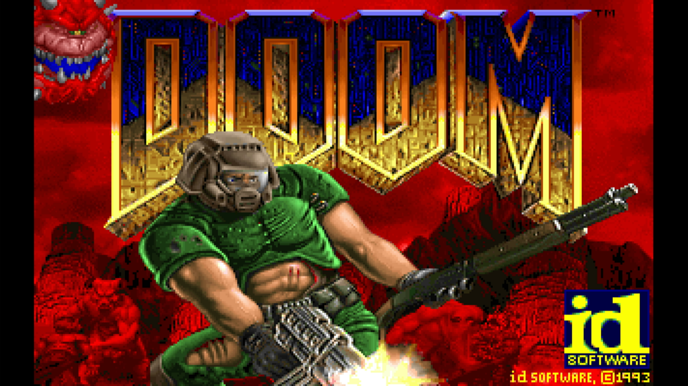

[Part 1](/rpi-hal/blog/doom-1-newlib/) got the Doom engine running on a
bare-metal Raspberry Pi 2B, on newlib with a Rust layer underneath. This
part covers how its frames get onto the screen, which turns out to be
the easy part of the port.

## Asking the GPU for a framebuffer

On a Pi, the display belongs to the GPU, the VideoCore, and its firmware
is still running underneath the program. The ARM side asks it for things
through the mailbox, a message-passing interface in rpi-hal's
[`mailbox`](https://docs.rs/rpi-hal/latest/rpi_hal/mailbox/) module.
Two requests are all a framebuffer takes:

```rust
let mut mailbox = Mailbox::new(peripherals.VCMAILBOX);

// What is the display running at?
let mode = mailbox.display_mode()?;

// Give me a buffer, 32 bits per pixel.
let framebuffer = mailbox.allocate_framebuffer(width, height, 32, PixelOrder::Bgr)?;
```

The answer is an address, a size, and a *pitch*: the number of bytes
from the start of one row to the start of the next. The pitch can be
more than `width * 4`, because the firmware may pad its rows. So drawing
pixel (x, y) means going to `y * pitch + x * 4`, not `(y * width + x) *
4`.

### Why `Bgr`

doomgeneric hands over its frame as 32-bit words of the form
`0x00RRGGBB`. The ARM core is little-endian, so that word sits in memory
as the bytes `BB GG RR 00`: blue first. The pixel order you ask the
firmware for describes the bytes in memory, so the right answer is
`Bgr`, even though the words look like RGB in the code. Ask for `Rgb`
and red and blue swap: the title screen's red sky comes out blue.

### Why `flush`

Every frame ends with `framebuffer.flush()`, and without it the screen
shows stale or partial frames.

The ARM core writes pixels through its data cache. Recently written
pixels can still be sitting in the cache, not yet in memory. The
VideoCore's display hardware reads the framebuffer straight from memory,
over the bus, so it never sees what's still in the cache. `flush`
writes back every cache line covering the framebuffer, and only then
is the frame really in memory where the display can read it.

## Drawing Doom

doomgeneric renders into its own 640×400 buffer, Doom's original
320×200 doubled. `DG_DrawFrame` copies it into the framebuffer a row at
a time, then flushes:

```rust
#[unsafe(no_mangle)]
pub extern "C" fn DG_DrawFrame() {
    let Some(screen) = critical_section::with(|cs| SCREEN.borrow(cs).get()) else {
        return;
    };
    let left = (screen.width - WIDTH) / 2;
    let top = (screen.height - HEIGHT) / 2;
    let pitch = screen.pitch_bytes as usize / 4;
    let base = screen.address as *mut u32;

    unsafe {
        for y in 0..HEIGHT as usize {
            let from = DG_ScreenBuffer.add(y * WIDTH as usize);
            let to = base.add((top as usize + y) * pitch + left as usize);
            core::ptr::copy_nonoverlapping(from, to, WIDTH as usize);
        }
    }
    screen.flush();
}
```

The frame is centered because the framebuffer is usually a little
bigger than it, in one direction. Why it's that size is the interesting
part.

## Letting the firmware scale for free

Doom's frame is 640×400, smaller than most displays. Copied into a
framebuffer at the display's own size, it would sit in the middle as a
small picture with black bars on all four sides. Scaling it up in
software would cost a lot of CPU time on every frame, and the Pi 2
doesn't have much to spare. So the GPU does it instead.

The firmware already scales: give it a framebuffer smaller than the
display, and it stretches the buffer to fill the screen as part of
sending it out, at no cost to the ARM. The catch is that it stretches
to fill the *whole* display. A 640×400 buffer on an 800×480 panel gets
stretched further horizontally than vertically, and everything comes
out too wide.

The trick is to allocate a buffer with the **display's shape**, just big
enough to hold Doom's frame. Because the buffer and the display have the
same proportions, the firmware scales it by the same amount in both
directions, and nothing is distorted. Doom's frame fills the buffer in
one direction and is centered in the other, so black bars appear on two
opposite sides at most, and only where the display isn't 8:5:

```rust
pub fn framebuffer_size(width: u32, height: u32) -> (u32, u32) {
    let (width, height) = (u64::from(width), u64::from(height));
    let (frame_width, frame_height) = (u64::from(WIDTH), u64::from(HEIGHT));
    if width * frame_height >= height * frame_width {
        // Wider than the frame: frame height, display shape.
        let scaled = (frame_height * width + height / 2) / height;
        (scaled as u32, HEIGHT)
    } else {
        // Narrower: frame width, display shape.
        let scaled = (frame_width * height + width / 2) / width;
        (WIDTH, scaled as u32)
    }
}
```

Because the buffer size comes from whatever display the firmware
reports at boot, the same image adapts to whatever is plugged in:

| Display | Shape | Framebuffer | Bars |
| --- | --- | --- | --- |
| 800×480 DSI panel | 5:3 | 667×400 | Thin, left and right |
| 1920×1080 monitor | 16:9 | 711×400 | Left and right |
| 1920×1200 monitor | 16:10 | 640×400 | None |
| 1024×768 monitor | 4:3 | 640×480 | Top and bottom |

Here's the title screen on a 1920×1080 monitor. The framebuffer is
711×400, and Doom's 640-wide frame fills 90% of it, which leaves the
two black bars at the sides. The picture is scaled up evenly, with
nothing stretched:



Asking the firmware for the display mode has a side benefit: it also
clears any overscan border the firmware would otherwise add for a TV,
which shrinks the picture.

:::note
On a CRT in 1993, Doom's 320×200 filled a 4:3 screen, so its pixels
were a little taller than they were wide. Square pixels at 8:5, as here,
show the picture slightly squashed vertically compared with how it
looked on a DOS PC. Chocolate Doom corrects for that by default;
this port doesn't, yet.
:::

## When the game ends

Quit Game from the menu, or a fatal error, ends in newlib's `_exit` (see
part 1). There's nothing to return to, so the board halts there, but
first `_exit` clears the framebuffer and flushes it. Otherwise the last
frame would stay on screen, which looks exactly like the board has
frozen. Any error message is on the serial console.

## What it doesn't do

There's no double buffering and no waiting for the display's vertical
refresh. Doom only updates its world 35 times a second, and in play
tearing hasn't been noticeable. If it
ever is, rpi-hal has what tear-free video takes: a framebuffer with
several pages
([`allocate_framebuffer_paged`](https://docs.rs/rpi-hal/latest/rpi_hal/mailbox/struct.Mailbox.html#method.allocate_framebuffer_paged)),
flipped between with `set_virtual_offset`.

## Next

That's the picture. [Part 3](/rpi-hal/blog/doom-3-usb-input/) covers
the keyboard, which on a Pi means being a USB host.
