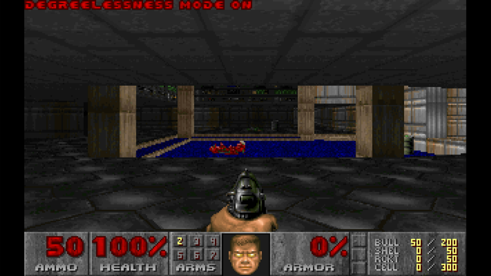

By the end of [part 2](/rpi-hal/blog/doom-2-framebuffer/), Doom was
running on a bare-metal Raspberry Pi 2B and drawing to the screen, but
all it could do was play its own demos. To play, it needs a keyboard.

On a PC in 1993 that meant a keyboard controller that raised an
interrupt with a scancode. A Raspberry Pi has no keyboard port, just
USB. Reading a USB keyboard means being a USB *host*: powering the bus,
finding out what's plugged in, configuring it, and asking it for data,
all of which an operating system normally does for you.

## The USB host

The Pi 2B's USB ports hang off a Synopsys DesignWare controller (DWC2),
through the board's on-board USB hub. rpi-hal has a host driver for it
in [`usb::dwc2`](https://docs.rs/rpi-hal/latest/rpi_hal/usb/dwc2/), and
on top of that, a HID boot keyboard in
[`usb::hid::keyboard`](https://docs.rs/rpi-hal/latest/rpi_hal/usb/hid/keyboard/).
Bring-up is four steps:

```rust
// The USB block is powered off until the firmware is asked.
usb::power_on(mailbox);

let dwc2 = DWC2.init(Dwc2Host::init(global, host, pwrclk, timer));

// The on-board hub is soldered on; give it a moment to appear.
while !dwc2.port_connected() && timer.now_micros() < deadline {
    timer.delay_ms(100);
}

// Walk the bus, through the hub, and keep the first keyboard.
usb::enumerate(dwc2, timer, |channel, timer, device| {
    match Keyboard::from_device(channel, timer, device) {
        Ok(Some(keyboard)) => {
            found = Some(keyboard);
            ControlFlow::Break(())
        }
        _ => ControlFlow::Continue(()),
    }
})?;
```

The bus is walked once, at boot. That keeps things simple, at the cost
of hotplug: the keyboard has to be plugged in before power-on. Without
one, the game runs anyway and plays its demos.

## The boot protocol

A full USB HID keyboard describes its own report format in a *report
descriptor*, which you're expected to parse. Keyboards also support a
simpler fixed format, the **boot protocol**, meant for PC BIOSes that
can't parse descriptors. That's all a game needs, so that's what's used.

A boot report is 8 bytes:

| Byte | Contents |
| --- | --- |
| 0 | Modifier bits: left and right Ctrl, Shift, Alt and GUI |
| 1 | Reserved |
| 2–7 | Up to six keys currently held, as HID usage codes |

The report says which keys are *down*, not what changed. rpi-hal's
`Keyboard` compares each report with the previous one and turns the
difference into press and release events.

Modifiers need the same treatment by hand. They arrive as bits in byte
0, not in the key list, so they never show up as press events. The
input code keeps the last report's modifier byte and compares:

```rust
let modifiers = events.report().modifiers;
for (was, is, code) in [
    (self.modifiers.ctrl(), modifiers.ctrl(), KEY_RCTRL),
    (self.modifiers.shift(), modifiers.shift(), KEY_RSHIFT),
    (self.modifiers.alt(), modifiers.alt(), KEY_RALT),
] {
    if was != is {
        self.push(is, code);
    }
}
self.modifiers = modifiers;
```

## Polling

Doom calls `DG_GetKey` once per tic, 35 times a second, repeating until
it returns "no more keys". The implementation hands out the events from
the last report first. Once they're gone, it asks the keyboard for a new
report, but at most every 10 ms, the interval a boot keyboard's
interrupt endpoint typically asks for. Polling faster than that upsets
the controller's scheduling of periodic transfers.

## Translating keys

Each HID usage code maps to one of the codes in doomgeneric's
`doomkeys.h`. Letters become lowercase ASCII, which is what the menus'
y/n prompts and the cheat codes expect. Typing `iddqd` works:



The first version followed doomgeneric's SDL port for the rest, and
that turned out to be a mistake.

## The bindings that disappeared

The SDL port doesn't always send keys. For some, it sends *actions*:
Ctrl arrives as `KEY_FIRE`, Space as `KEY_USE`, comma and period as
`KEY_STRAFE_L` and `KEY_STRAFE_R`. Out of the box that plays fine.

Then you quit the game. Quitting saves the config to `default.cfg`, and
Doom stores key bindings the way DOS Doom did, as **DOS keyboard
scancodes**: `key_fire 29` means the key with scancode 29, which is
Ctrl. The engine converts each binding to a scancode through a table,
and `KEY_FIRE` and its friends have no scancode, because they're not
keys. They were written out raw, as 160 to 163.

On the next boot, loading the config converted those numbers back
through the same table, found nothing, and bound them to 0. After one
Quit Game, fire, use and both strafes were unbound. It also meant those
controls could never be rebound by editing the file, and a
`DEFAULT.CFG` from a real DOS install didn't work.

The fix is to send keys, never actions. Ctrl is `KEY_RCTRL`, Space is
`' '`, comma is `','`, and what each one *does* is up to the bindings.
The engine's defaults are back to vanilla Doom's (`key_fire` is Ctrl,
`key_use` is Space), so out of the box nothing changes, but now every
binding survives a save and load. The keyboard map now also covers
everything that table can round-trip: punctuation, Insert, Delete, Home,
End, Page Up and Down, the lock keys and the keypad. Num Lock is the one
key left out, because it has no scancode to save.

## Rebinding

Like the original, there's no key-binding menu. Rebinding means editing
`doom/default.cfg` on the card. Each `key_*` line takes a DOS scancode,
so for WASD:

```text
key_up      17
key_down    31
key_strafeleft  30
key_straferight 32
```

That's a step backwards in convenience, but it's faithful: a
`DEFAULT.CFG` from a real DOS install now works as-is.

## Next

Doom runs, draws and plays. It's still silent.
[Part 4](/rpi-hal/blog/doom-4-audio/) adds sound effects and music, on
a core of their own.
