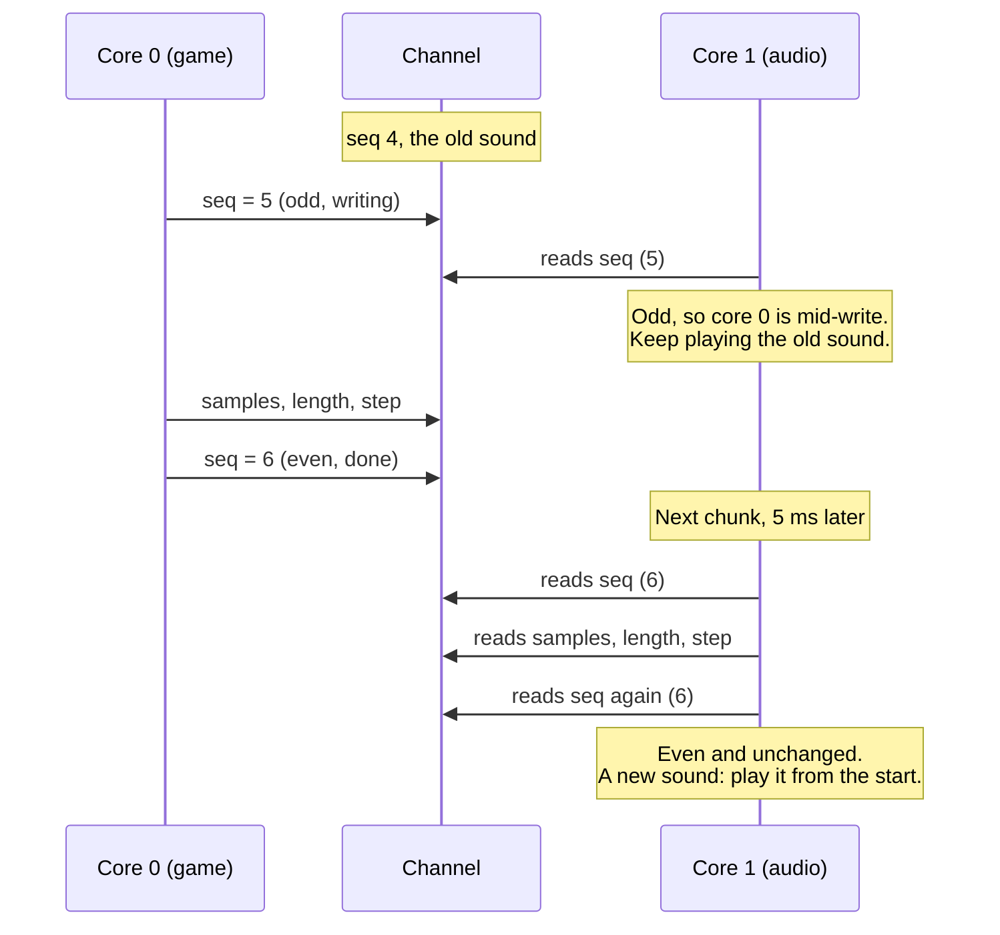

Over the first three parts, Doom got running on a bare-metal Raspberry
Pi 2B ([part 1](/rpi-hal/blog/doom-1-newlib/)), onto the screen
([part 2](/rpi-hal/blog/doom-2-framebuffer/)) and under a USB keyboard
([part 3](/rpi-hal/blog/doom-3-usb-input/)). It was silent. This last
part adds sound effects and the music.

Here's where it ends up, sound effects and music together:

<iframe
  src="https://www.youtube-nocookie.com/embed/kI7jSnXz3NY"
  title="Doom on a bare-metal Raspberry Pi 2B, now with sound and music"
  style="display: block; width: 100%; aspect-ratio: 16 / 9; border: 0;"
  allow="accelerometer; autoplay; clipboard-write; encrypted-media; gyroscope; picture-in-picture; web-share"
  referrerpolicy="strict-origin-when-cross-origin"
  allowfullscreen
></iframe>

## A core of its own

Audio is unforgiving about timing. The hardware wants a steady stream of
samples, and if it runs dry, even for a few milliseconds, you hear a
click or a gap. Doom is the opposite of steady. Some frames take longer
than others, and loading a level stalls the game for a second or more.

The Pi 2B has four cores, and Doom uses one. So audio gets a second core
to itself. Core 1 owns the audio hardware outright and produces every
sample itself, as the hardware asks for it. Core 0, the game, never has
to keep it fed. It only says which sounds are playing, and core 1 does
the rest.

## Getting samples out of the jack

The Pi's 3.5 mm jack has no audio chip behind it. It's two PWM (pulse
width modulation) outputs, on GPIO40 and GPIO45, through a filter on the
board. The PWM output switches between high and low very fast, and the
fraction of time it spends high is the sample's value. The filter
smooths that into a voltage, and the voltage is the sound.

The setup, in [`src/audio.rs`](https://github.com/joeferner/rpi-doom/blob/main/src/audio.rs):

- **The PWM runs in FIFO mode.** Samples go into a small queue instead
  of a register, and the two channels take alternate words from it, so
  samples are interleaved left, right, left, right.
- **DMA fills the FIFO.** No core writes a register per sample. DMA
  channel 5 copies samples from memory into the FIFO, paced by the PWM's
  own data request signal (DREQ), so it moves a word exactly when the
  FIFO has room.
- **Two buffers, double-buffered.** The DMA plays one 256-frame chunk
  while core 1 fills the other. Filling blocks until the DMA is done
  with the chunk, so the loop is paced by the audio hardware and needs
  no timer.

The sample rate comes from dividing a clock. The PWM's clock is 500 MHz,
divided by 10, and each sample is a duty cycle out of 1,024 steps (10
bits). 500 MHz / 10 / 1,024 is **48,828 Hz**. That's not quite the usual
48,000 Hz, but the integer divider can't express 48,000, and everything
downstream is simply told the real rate.

At 48,828 Hz, a 256-frame chunk lasts 5,242 µs. That's the budget: core
1 has to mix every chunk in less time than the chunk takes to play.

Rust's side of this is mostly rpi-hal
([`pwm`](https://docs.rs/rpi-hal/latest/rpi_hal/pwm/) and
[`dma`](https://docs.rs/rpi-hal/latest/rpi_hal/dma/)), and core 1's
whole job fits in one loop:

```rust
loop {
    // Blocks until the DMA is done with the chunk being refilled.
    stream.feed(|buf| fill(&mut mixer, &mut clock, &timer, buf));
    if stream.is_error() {
        halt();
    }
}
```

The first thing it played was a quiet 440 Hz test tone, to check it
stayed steady through everything the game could throw at it.

## Sound effects

Doom's sound effects are lumps in the WAD (`DSPISTOL`, `DSDOROPN`, ...)
in the format of DMX, the sound library DOS Doom used: a short header,
then unsigned 8-bit mono samples, mostly at 11,025 Hz. The engine's
sound module, in C, finds the lump, checks the header, and hands the
samples to the mixer on core 1 straight out of the engine's lump cache.
Nothing is converted or copied, because the engine keeps the lump in
memory, at the same address, for as long as it might be playing.

The mixer, in [`src/sound.rs`](https://github.com/joeferner/rpi-doom/blob/main/src/sound.rs),
has 16 channels. For each playing sound, core 1 steps through the
samples at `sample rate / output rate` per output frame, in 16.16 fixed
point, interpolating linearly between neighbors. Each channel has a
left and right gain for stereo position. The channels are summed,
clipped to 16 bits, and converted to PWM duty cycles.

### Handing a sound across, without a lock

Core 0 starts sounds, and core 1 plays them. Starting a sound means
handing over three values: where the samples are, how many there are,
and the step. Core 1 has to see all three from the same start, never
the new address with the old length.

A lock would do it, but core 1 mustn't wait on core 0. Instead, each
channel uses a **seqlock**: a sequence number that core 0 makes odd
before writing the three values and even again after. Core 1 reads the
number, then the values, then the number again. It only takes the
values if the number was even and didn't change; otherwise core 0 was
mid-write, and core 1 tries again next chunk, 5 ms later. A new even
number means a new sound, which core 1 starts from the beginning.

Here's a start that core 1 catches halfway through:



Volume and stereo position change while a sound plays, as the monster
making it moves. Those are both packed into one 32-bit word, which is
always read whole, so they need no seqlock.

## Music

Doom's music is the part people remember, and it's not a recording.
On DOS it was a score, played live by the sound card's synthesizer chip.
On the common cards, the Sound Blaster and AdLib, that was a Yamaha OPL,
an FM synthesis chip. Getting the original sound means emulating that
chip.

The path from the WAD to the speaker is long:

1. **The song** is a `D_*` lump in MUS, a compact MIDI-like format id
   used.
2. **MUS to MIDI**: doomgeneric includes `mus2mid.c`.
3. **MIDI to OPL register writes**: Chocolate Doom's OPL music player,
   `i_oplmusic.c`, plays the MIDI through instrument definitions stored
   in the WAD's `GENMIDI` lump, just as DMX did. doomgeneric leaves it
   out, so rpi-doom carries a copy, with its changes marked.
4. **OPL register writes to samples**: an emulated OPL3. That's Nuked
   OPL3, an emulator accurate to the chip's actual circuits, in a
   [Rust port](https://github.com/tgies/nuked-opl3-rs).

The player doesn't render audio itself. It schedules callbacks ("in N
microseconds, play the next event"), and expects whoever renders the
chip's samples to advance a clock and fire each callback when it comes
due. Here that's core 1, a chunk at a time. Each chunk is rendered in
slices that end exactly where the next event is due, so every note
starts on the right sample.

The music is rendered first, and the sound effects are mixed on top of
it. The in-game music volume works by changing the chip's own registers,
as on a real sound card.

Core 0 still touches the music: it starts songs, changes them and sets
the volume. That needs a lock around the chip and the player's state,
but not the [critical-section](https://crates.io/crates/critical-section)
crate's, which rpi-hal makes a lock shared between the cores. Core 0
holds that one through whole SD card reads, and core 1 waiting on one
of those could run the audio dry. The music has its own lock, which
core 0 only holds for a song or volume change.

## So, can it run Doom?

Yes. On a Raspberry Pi 2B with no operating system, the 1993 engine runs
in C on newlib, on top of a Rust layer for memory, files, the screen,
the keyboard and sound. Core 0 plays the game. Core 1 mixes the sound
effects and plays the original OPL score on an emulated FM chip, with
about a third of its time to spare.

The code is in [rpi-doom](https://github.com/joeferner/rpi-doom). Bring
your own WAD.
